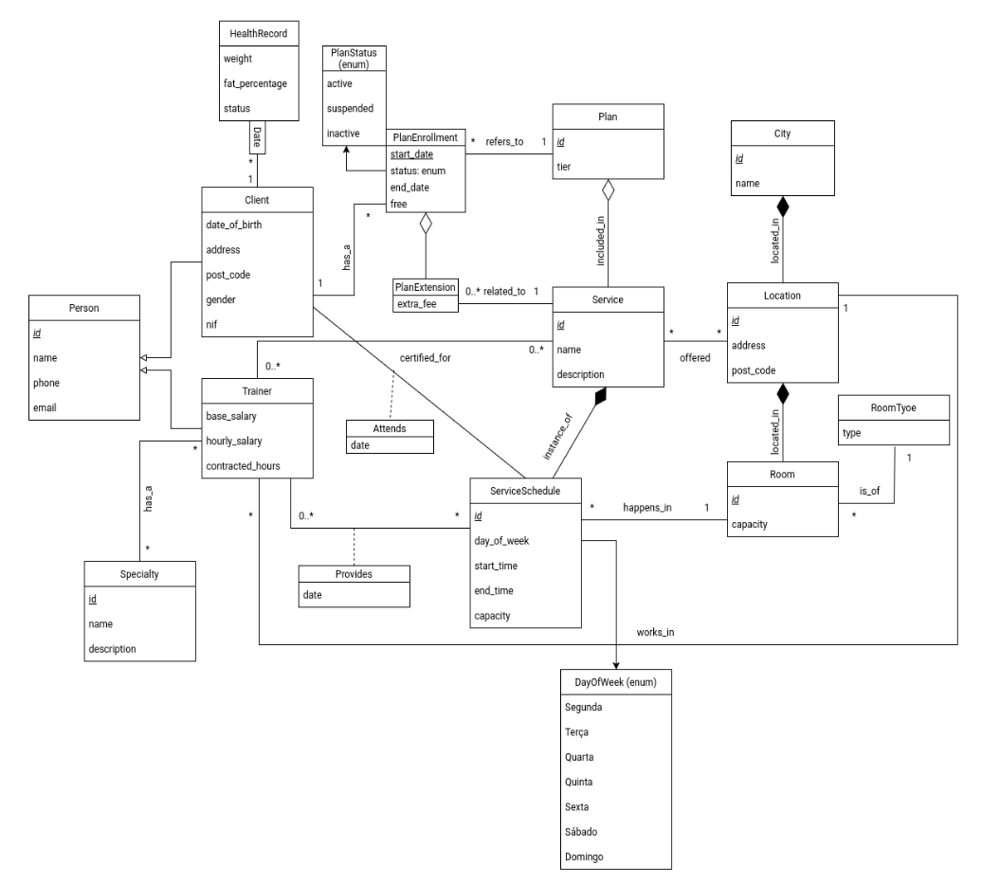

# ltw03g06

## First Delivery
- Signup page: Accessed by clicking the "JOIN US" button on the main page.
- Profile page: Accessed by clicking the profile icon in the top right corner.
- Classes page.
Run using php -S localhost:9000

## Mockup
(https://www.figma.com/design/hI5sROxEz4giQGAlM8Ryiz/GYM-MOCKUP?node-id=0-1&t=E1JRo00MHPRfN3h8-1)

## UML Domain Model

## Features

**All users:**
- [X] Register a new account.
- [X] Log in and out.
- [X] Edit their profile, including name, username, password, and profile photo.

**Members:**
- [x] Browse the schedule of available fitness classes, filtering by type, trainer, day, or time.
- [x] Enroll in and cancel enrollment from upcoming classes, subject to capacity limits.
- [x] View trainer profiles, including their specializations and the classes they teach.
- [x] Check the current availability of equipment in the main training area.
- [x] Leave ratings and reviews for classes they have attended.

The class schedule page now uses AJAX live search so filters update the session list without a full page reload.

**Trainers:**
- [ ] Manage their public profile, including bio, specializations, and certifications.
- [ ] View the roster of members enrolled in their classes.
- [ ] Track and manage their assigned class schedule.

**Admins:**
- [ ] Manage members and trainers (create, update, and deactivate accounts).
- [ ] Manage the class catalog (create, edit, and remove classes) and assign trainers to them.
- [ ] Manage equipment in the main training area (add, update availability status, and remove items).
- [ ] Elevate a user to admin status.
- [ ] Oversee and ensure the smooth operation of the entire system.

**Extra:**
- [ ] Something extra (e.g., personal training bookings, membership plans, waitlist, ...).

## Running

    sqlite3 database/database.db < database/database.sql
    php -S localhost:9000

## Credentials

- admin/p4s5w0rd
- member/1234
- trainer/1234